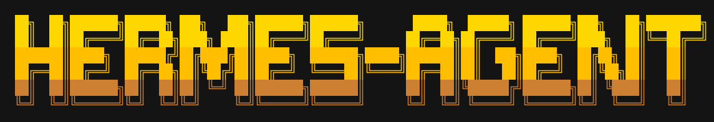

<p align="center">
  
</p>

# Агент Гермес (Hermes Agent) ☤

<p align="center">
  <a href="https://hermes-agent.nousresearch.com/docs/"></a>
  <a href="https://discord.gg/NousResearch"></a>
  <a href="https://github.com/developer3000S/hermes-agent-rus/blob/main/LICENSE"></a>
  <a href="https://nousresearch.com"></a>
</p>

**Самообучающийся ИИ-агент, созданный [Nous Research](https://nousresearch.com).** Это единственный агент со встроенным циклом обучения — он создает навыки на основе опыта, совершенствует их в процессе использования, побуждает себя сохранять знания, ищет в своих прошлых разговорах и строит углубляющуюся модель того, кто вы есть, на протяжении сессий. Запускайте его на VPS за 5 долларов, в кластере GPU или на серверной инфраструктуре, которая почти ничего не стоит в простое. Он не привязан к вашему ноутбуку — общайтесь с ним через Telegram, пока он работает на облачной виртуальной машине.

Используйте любую модель — [Nous Portal](https://portal.nousresearch.com), [OpenRouter](https://openrouter.ai) (более 200 моделей), [NVIDIA NIM](https://build.nvidia.com) (Nemotron), [Xiaomi MiMo](https://platform.xiaomimimo.com), [z.ai/GLM](https://z.ai), [Kimi/Moonshot](https://platform.moonshot.ai), [MiniMax](https://www.minimax.io), [Hugging Face](https://huggingface.co), OpenAI или вашу собственную конечную точку. Переключайтесь с помощью `hermes model` — без изменений кода и привязки к поставщику.

<table>
<tr><td><b>Настоящий терминальный интерфейс</b></td><td>Полноценный TUI с многострочным редактированием, автодополнением слэш-команд, историей разговоров, прерыванием и перенаправлением, а также потоковым выводом инструментов.</td></tr>
<tr><td><b>Живет там же, где и вы</b></td><td>Telegram, Discord, Slack, WhatsApp, Signal и CLI — все через единый процесс шлюза. Транскрипция голосовых заметок, непрерывность разговора между платформами.</td></tr>
<tr><td><b>Замкнутый цикл обучения</b></td><td>Курируемая агентом память с периодическими подсказками. Автономное создание навыков после сложных задач. Самосовершенствование навыков в процессе использования. Поиск по сессиям FTS5 с обобщением LLM для припоминания между сессиями. Моделирование пользователя <a href="https://github.com/plastic-labs/honcho">Honcho</a>. Совместимость с открытым стандартом <a href="https://agentskills.io">agentskills.io</a>.</td></tr>
<tr><td><b>Плановые автоматизации</b></td><td>Встроенный планировщик cron с доставкой на любую платформу. Ежедневные отчеты, ночные бэкапы, еженедельные аудиты — все на естественном языке, работающее без присмотра.</td></tr>
<tr><td><b>Делегирует и параллелит</b></td><td>Запускайте изолированных субагентов для параллельных рабочих потоков. Пишите скрипты на Python, которые вызывают инструменты через RPC, сворачивая многошаговые конвейеры в ходы с нулевой стоимостью контекста.</td></tr>
<tr><td><b>Работает везде, а не только на ноутбуке</b></td><td>Семь бэкендов терминала — локальный, Docker, SSH, Singularity, Modal, Daytona и Vercel Sandbox. Daytona и Modal предлагают серверную персистентность — среда вашего агента переходит в спящий режим при простое и просыпается по запросу, почти ничего не стоя между сессиями. Запускайте его на VPS за 5 долларов или в кластере GPU.</td></tr>
<tr><td><b>Готов к исследованиям</b></td><td>Генерация пакетов траекторий, среды обучения с подкреплением Atropos, сжатие траекторий для обучения следующего поколения моделей вызова инструментов.</td></tr>
</table>

---

## Быстрая установка

### Linux, macOS, WSL2, Termux

```bash
curl -fsSL https://raw.githubusercontent.com/developer3000S/hermes-agent-rus/main/scripts/install.sh | bash
```

### Windows (нативно, PowerShell) — Ранняя бета

> **Внимание:** Нативная поддержка Windows находится на стадии **ранней беты**. Она устанавливается и работает, но не была протестирована так широко, как наши пути для Linux/macOS/WSL2. Пожалуйста, [создавайте тикеты (issues)](https://github.com/developer3000S/hermes-agent-rus/issues), если столкнетесь с проблемами. Для наиболее стабильной работы в Windows сегодня используйте установку через **WSL2**.

Запустите это в PowerShell:

```powershell
irm https://raw.githubusercontent.com/developer3000S/hermes-agent-rus/main/scripts/install.ps1 | iex
```

Инсталлятор берет на себя все: uv, Python 3.11, Node.js, ripgrep, ffmpeg, **и портативный Git Bash** (MinGit, распакованный в `%LOCALAPPDATA%\hermes\git` — права администратора не требуются, полная изоляция от системного Git). Гермес использует этот встроенный Git Bash для выполнения консольных команд.

Если у вас уже установлен Git, инсталлятор обнаружит его и будет использовать. В противном случае потребуется загрузка MinGit (~45 МБ) — он не затронет системный Git и не будет с ним конфликтовать.

> **Android / Termux:** Протестированный путь ручной установки описан в [руководстве по Termux](https://hermes-agent.nousresearch.com/docs/getting-started/termux). В Termux Гермес устанавливает специальный набор `.[termux]`, так как полный набор `.[all]` в настоящее время подтягивает зависимости для голоса, несовместимые с Android.
>
> **Windows:** Нативная Windows поддерживается в режиме **ранней беты** — команда PowerShell выше установит всё необходимое, но будьте готовы к возможным проблемам и сообщайте о них. Если вы предпочитаете WSL2 (наш самый проверенный путь для Windows), команда для Linux работает и там. Нативная установка Windows находится в `%LOCALAPPDATA%\hermes`; установка в WSL2 — в `~/.hermes`, как в Linux. Единственная функция Гермеса, которой сейчас требуется именно WSL2, — это панель чата в дашборде на базе браузера (она использует POSIX PTY — классический CLI и шлюз работают нативно).

После установки:

```bash
source ~/.bashrc    # перезагрузить оболочку (или: source ~/.zshrc)
hermes              # начать общение!
```

---

## С чего начать

```bash
hermes              # Интерактивный CLI — начать разговор
hermes model        # Выбрать провайдера LLM и модель
hermes tools        # Настроить включенные инструменты
hermes config set   # Установить отдельные значения конфигурации
hermes gateway      # Запустить шлюз сообщений (Telegram, Discord и т. д.)
hermes setup        # Запустить мастер полной настройки (настраивает все сразу)
hermes claw migrate # Мигрировать из OpenClaw (если переходите с него)
hermes update       # Обновиться до последней версии
hermes doctor       # Диагностировать проблемы
```

📖 **[Полная документация →](https://hermes-agent.nousresearch.com/docs/)**

## CLI vs Сообщения: Краткая справка

У Гермеса есть две точки входа: запустить терминальный интерфейс командой `hermes` или запустить шлюз и общаться с ним через Telegram, Discord, Slack, WhatsApp, Signal или Email. После начала разговора многие слэш-команды будут общими для обоих интерфейсов.

| Действие | CLI | Платформы сообщений |
|---------|-----|---------------------|
| Начать чат | `hermes` | Выполнить `hermes gateway setup` + `hermes gateway start`, затем отправить боту сообщение |
| Начать новый разговор | `/new` или `/reset` | `/new` или `/reset` |
| Сменить модель | `/model [провайдер:модель]` | `/model [провайдер:модель]` |
| Установить личность | `/personality [имя]` | `/personality [имя]` |
| Повторить или отменить последний ход | `/retry`, `/undo` | `/retry`, `/undo` |
| Сжать контекст / проверить использование | `/compress`, `/usage`, `/insights [--days N]` | `/compress`, `/usage`, `/insights [дни]` |
| Просмотреть навыки | `/skills` или `/<имя-навыка>` | `/<имя-навыка>` |
| Прервать текущую работу | `Ctrl+C` или отправить новое сообщение | `/stop` или отправить новое сообщение |
| Статус конкретной платформы | `/platforms` | `/status`, `/sethome` |

Полные списки команд см. в [руководстве по CLI](https://hermes-agent.nousresearch.com/docs/user-guide/cli) и [руководстве по шлюзу сообщений](https://hermes-agent.nousresearch.com/docs/user-guide/messaging).

---

## Документация

Вся документация доступна по адресу **[hermes-agent.nousresearch.com/docs](https://hermes-agent.nousresearch.com/docs/)**:

| Раздел | Что охвачено |
|---------|---------------|
| [Быстрый старт](https://hermes-agent.nousresearch.com/docs/getting-started/quickstart) | Установка → настройка → первый разговор за 2 минуты |
| [Использование CLI](https://hermes-agent.nousresearch.com/docs/user-guide/cli) | Команды, горячие клавиши, личности, сессии |
| [Конфигурация](https://hermes-agent.nousresearch.com/docs/user-guide/configuration) | Файл конфигурации, провайдеры, модели, все опции |
| [Шлюз сообщений](https://hermes-agent.nousresearch.com/docs/user-guide/messaging) | Telegram, Discord, Slack, WhatsApp, Signal, Home Assistant |
| [Безопасность](https://hermes-agent.nousresearch.com/docs/user-guide/security) | Одобрение команд, сопряжение DM, изоляция контейнеров |
| [Инструменты и наборы инструментов](https://hermes-agent.nousresearch.com/docs/user-guide/features/tools) | 40+ инструментов, система наборов, бэкенды терминала |
| [Система навыков](https://hermes-agent.nousresearch.com/docs/user-guide/features/skills) | Процедурная память, Skills Hub, создание навыков |
| [Память](https://hermes-agent.nousresearch.com/docs/user-guide/features/memory) | Постоянная память, профили пользователей, лучшие практики |
| [Интеграция MCP](https://hermes-agent.nousresearch.com/docs/user-guide/features/mcp) | Подключение любого сервера MCP для расширения возможностей |
| [Планирование Cron](https://hermes-agent.nousresearch.com/docs/user-guide/features/cron) | Запланированные задачи с доставкой на платформу |
| [Контекстные файлы](https://hermes-agent.nousresearch.com/docs/user-guide/features/context-files) | Контекст проекта, формирующий каждый разговор |
| [Архитектура](https://hermes-agent.nousresearch.com/docs/developer-guide/architecture) | Структура проекта, цикл агента, основные классы |
| [Участие в разработке](https://hermes-agent.nousresearch.com/docs/developer-guide/contributing) | Настройка разработки, процесс PR, стиль кода |
| [Справочник CLI](https://hermes-agent.nousresearch.com/docs/reference/cli-commands) | Все команды и флаги |
| [Переменные окружения](https://hermes-agent.nousresearch.com/docs/reference/environment-variables) | Полный справочник переменных окружения |

---

## Миграция с OpenClaw

Если вы переходите с OpenClaw, Гермес может автоматически импортировать ваши настройки, воспоминания, навыки и API-ключи.

**Во время первой настройки:** Мастер настройки (`hermes setup`) автоматически обнаруживает `~/.openclaw` и предлагает выполнить миграцию до начала конфигурации.

**В любое время после установки:**

```bash
hermes claw migrate              # Интерактивная миграция (полный пресет)
hermes claw migrate --dry-run    # Предпросмотр того, что будет мигрировано
hermes claw migrate --preset user-data   # Миграция без секретов
hermes claw migrate --overwrite  # Перезаписать существующие конфликты
```

Что импортируется:
- **SOUL.md** — файл личности
- **Воспоминания** — записи MEMORY.md и USER.md
- **Навыки** — созданные пользователем навыки → `~/.hermes/skills/openclaw-imports/`
- **Белый список команд** — шаблоны одобрения
- **Настройки сообщений** — конфиги платформ, разрешенные пользователи, рабочий каталог
- **API-ключи** — разрешенные секреты (Telegram, OpenRouter, OpenAI, Anthropic, ElevenLabs)
- **TTS-активы** — аудиофайлы рабочей области
- **Инструкции рабочей области** — AGENTS.md (с `--workspace-target`)

См. `hermes claw migrate --help` для всех опций или используйте навык `openclaw-migration` для интерактивной миграции под руководством агента с предварительным просмотром.

---

## Участие в разработке

Мы приветствуем вклад в проект! См. [Руководство для разработчиков](https://hermes-agent.nousresearch.com/docs/developer-guide/contributing) для получения информации о настройке среды разработки, стиле кода и процессе PR.

Быстрый старт для разработчиков — клонируйте и запускайте с `setup-hermes.sh`:

```bash
git clone https://github.com/developer3000S/hermes-agent-rus.git
cd hermes-agent
./setup-hermes.sh     # устанавливает uv, создает venv, устанавливает .[all], создает симлинк ~/.local/bin/hermes
./hermes              # автоопределяет venv, не нужно предварительно выполнять `source`
```

Ручной путь (эквивалент вышеуказанного):

```bash
curl -LsSf https://astral.sh/uv/install.sh | sh
uv venv .venv --python 3.11
source .venv/bin/activate
uv pip install -e ".[all,dev]"
scripts/run_tests.sh
```

> **Обучение RL (опционально):** Интеграция RL/Atropos (`environments/`) — см. [`CONTRIBUTING.md`](https://github.com/developer3000S/hermes-agent-rus/blob/main/CONTRIBUTING.md#development-setup) для полной настройки.

---

## Сообщество

- 💬 [Discord](https://discord.gg/NousResearch)
- 📚 [Skills Hub](https://agentskills.io)
- 🐛 [Ошибки (Issues)](https://github.com/developer3000S/hermes-agent-rus/issues)
- 🔌 [HermesClaw](https://github.com/AaronWong1999/hermesclaw) — Мост сообщества для WeChat: запуск Hermes Agent и OpenClaw на одном аккаунте WeChat.

---

## Лицензия

MIT — см. [LICENSE](LICENSE).

Разработано [Nous Research](https://nousresearch.com).
